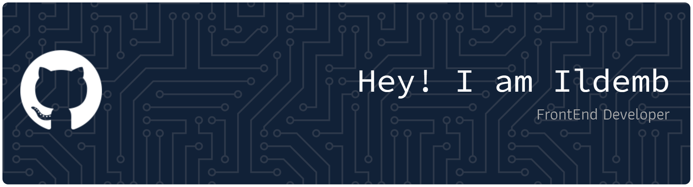

  

  <!-- Animated Text Reveal (Simulating CSS motion) -->
  
   
  
  
  

---

## 🚀 Professional Summary | What I Bring to the Table

> *Um desenvolvedor frontend apaixonado por criar interfaces modernas, dinâmicas e interativas. Sempre focado em transformar ideias em códigos limpos e eficientes.*[cite: 1]

* **User-Centric Design:** Bridging the gap between aesthetic design and functional performance.
* **Modern Stack Proficiency:** Fast, responsive, and scalable development using React, Tailwind, and Node.js.
* **Problem Solver:** Dedicated to clean code, semantic structures, and continuous learning.

---

## 🕹️ Skills & Tools Grid

  
### 💻 Frontend & Languages

### ⚙️ Backend & Mobile

### 🎨 Design & Tools

---

## 📊 Estatísticas e Histórico

  
  <!-- O título não pode conter acentos para evitar que o proxy do GitHub quebre a imagem -->
  

    
  
  <!-- URL ajustado sem a barra extra para prevenir erros de 404 na API -->
  

---

## 📞 Contact Me

  
Let's build something awesome together.

  
  
  
  

